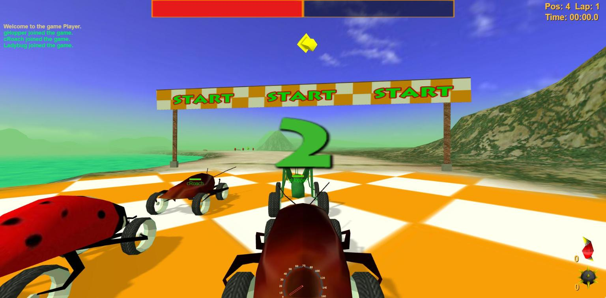

# Bugged Out Rally, Restored

A browser port of **Bugged Out Rally** (Inoculous Games, 2004), a combat racing game where you drive bugs on wheels. Built with three.js and TypeScript, using the original assets and rules.



## 👨‍💻 Development

1. Clone the repository and install the dependencies:

```bash
git clone git@github.com:jhm-ciberman/bugged-out-rally-restored.git
cd bugged-out-rally-restored
npm ci
```

2. Start the development server:

```bash
npm run dev
```

Then open [http://localhost:5173](http://localhost:5173) in your browser.

- [three.js](https://threejs.org/) for the 3D rendering
- [three-mesh-bvh](https://github.com/gkjohnson/three-mesh-bvh) for the collision ray casts
- [TypeScript](https://www.typescriptlang.org/) and [Vite](https://vite.dev/)
- Node 20.19+ or 22.12+

To build the static site into `dist/`:

```bash
npm run build
```

## 🧹 Code Style

```bash
npm run lint
```

Code style is checked and fixed with [Biome](https://biomejs.dev/).

## 🧪 Testing

```bash
npm test
```

Tests use [Vitest](https://vitest.dev/) as the testing framework.

## 🔗 URL Parameters

Shortcuts for development. They can be combined.

| Parameter | Description |
|-----------|-------------|
| `?track=N` | Skips the menus and starts a race on track `N` (1 to 8) |
| `&event=single` | The event for `?track`: `single` (3 bots), `circuit` (5 bots) or `explore` (no bots). Default `single` |
| `&car=Cockroach` | The bug for `?track`, by its datablock name. Default `Cockroach` |
| `&winnings=N` | The player's winnings for `?track`, which pick the opponents' bugs. Default `0` |
| `?fly` | Loads the track with a free camera instead of a race |
| `?cam=x,y,z&look=x,y,z` | Puts the free camera at a position, looking at a point |
| `?mute` | Starts with the sound off |
| `?debug` | Shows the debug panel (also F2) |
| `?nofog` | Starts with the fog off |
| `?view=N` | Draws `N` times as far as the original |

## 🎮 The Game

- **8 tracks**: Croaky Pond, Turtle Creek, Twin Peaks, Boomerang II, Snowbound, Ocean Side, Dunes II and Lunar.
- **8 bugs**, unlocked with race winnings: Beetle, Ladybug, Cockroach, Grasshopper, Hornet, Praying Mantis, Scorpion and BlackWidow.
- **3 events**: Explore (no opponents), Single Event (3 bots) and Race Circuit (5 bots).
- Zinger rockets, Magno bombs, boost pads, hazards (frogs, boulders, water), player profiles and the original menus.
- It is the full version: the demo limits of the original are not ported.

Profiles and settings are saved in the browser.

## 🕹️ Controls

| Key | Action |
|-----|--------|
| Arrow keys, or W and S plus the mouse | Drive and steer |
| Space | Brake |
| A or left mouse button | Fire a Zinger |
| D or right mouse button | Drop a Magno bomb |
| E | Zoom |
| R | Change the zoom level |
| Tab | First or third person |
| Enter | Put the car back on the track |
| Page Up / Page Down | Scroll the message log |
| Escape | In-race menu |

Keys can be remapped in Options, Controls.

## 🔧 How It Was Restored

The goal is to play like the original, not like a remake. Every value was taken from the original files where possible, and the result was checked side by side against the original game.

- **Scripts**: the original game logic is TorqueScript, shipped compiled. The scripts were decompiled with [dso-sharp](https://github.com/Elletra/dso-sharp) and read as the reference for the rules, menus, datablocks and sounds.
- **Assets**: models (DTS) and buildings (DIF) were converted to glTF with small Python tools. Terrain, missions, textures and sounds are used as they are.
- **Engine behaviour**: the C++ engine is stock Torque 1.5.2, so its public source explains most of it. The parts the game changed (bot driving and targeting, race positions, the wrong-way warning) were decoded from the original executable.
- **Checking**: a script runs the original game, places the camera or the car, logs positions and speeds, and takes screenshots. Physics, bot lap times, shadows, the HUD and the menus were compared against it.

Some original bugs that broke a feature by accident were fixed. Ones that are part of how the game plays were kept.

## 🙏 Credits

Bugged Out Rally was made by **Inoculous Games**:

- **Akio Cullum**: producer, programmer and art.
- **Thomas Cullum**: soundtrack.

The original game was powered by the Torque Game Engine by GarageGames.

## 🔒 License

All game assets (models, textures, sounds and music) belong to their original authors.

It is not my intention to break anyone's copyright in any way. I played Bugged Out Rally as a child and loved it, and this project exists only to preserve it so future generations can still play it.

If you hold the rights to Bugged Out Rally and want this removed, please open an issue and it will be taken down as soon as possible.
